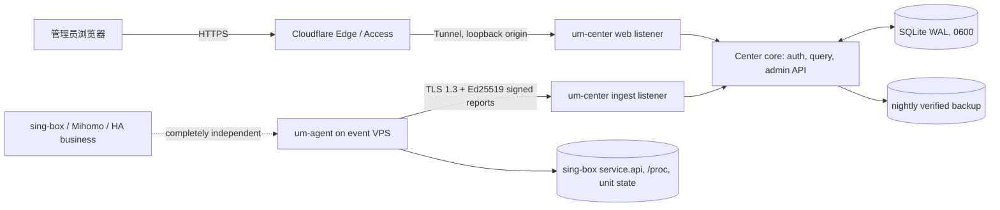
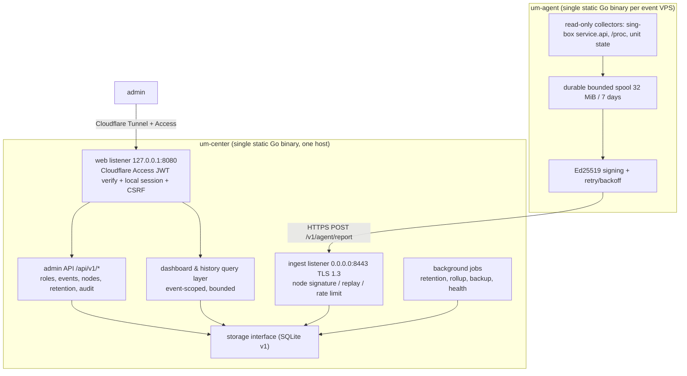

# UM-A 03 — Architecture, data flow, trust boundaries and permission matrix

Status: design freeze for UM-A review. No implementation exists in this PR.

## 1. System context

The center is a **management plane**: no client traffic passes through it and
its outage stops only telemetry (agents spool locally; all business services
continue).

## 2. Component view

Separation rule: the web listener has **no** route tree entry under `/v1/agent/*`
and the ingest listener has **no** route tree entry under `/api/*`; the two
servers are distinct `http.Server` instances with distinct handlers, timeouts,
body limits and middleware stacks. Only `adminapi`/`query` consult sessions;
only `ingestlisten` consults node keys. This is enforced by routing constants and
tested (UM-B/C security tests), not by comments.

## 3. Admin-plane data flow

1. Browser → Cloudflare edge → Access policy (identity provider, e.g. email OTP)
   → Cloudflare Tunnel → `127.0.0.1:8080`.
2. Center verifies the `Cf-Access-Jwt-Assertion` JWT (team JWKS, issuer, `aud`,
   `exp`/`nbf`, algorithm allowlist, bounded key cache). Invalid → 403 before any
   login form. The tunnel is the only path to the web listener.
3. Local login: username + password (Argon2id) + TOTP (RFC 6238, single-use
   counter). Rate limited; failures audited. Success → server-side session bound
   to the verified Cloudflare Access subject (`sub`/email hash stored in the
   session) + per-session CSRF token. Every subsequent web request must present
   a valid Access JWT whose subject matches the session binding; JWT
   expiry/subject change invalidates that request (403), and no request is
   authorized by the header alone. Session revocation on password/TOTP/recovery
   changes or admin action is immediate.
4. Dashboard/history GETs are read-only and event-scoped. Mutations (events,
   nodes, enroll tokens, revocation, retention, user administration) require the
   session's CSRF token and are role-checked and audited.
5. No response contains raw credentials, private YAML, node private keys, device
   identities, source/destination IPs or raw connection data; only bounded
   aggregate projections.

## 4. Machine-plane data flow

1. Operator provisions an event VPS: install agent package (root only for
   install/systemd), then agent runs as unprivileged `umagent`. One-time
   bootstrap token (event-scoped, single use, ≤15 min TTL) is placed in a 0600
   root-owned provisioning file; the agent consumes and deletes it.
2. Agent generates its Ed25519 keypair locally, calls `POST /v1/agent/enroll`
   over TLS (token in `Authorization`, key proof in body), receives `node_id`,
   `event_id`, `key_id`, `config_version`, per-event `device_salt`, sync state.
3. Agent gathers only allowlisted facts, creates a durable record with a stable
   `report_id` + `collected_at`, and signs each transmission attempt with fresh
   `sent_at`/`nonce`/`seq` headers. It POSTs to
   `https://ingest.132431.xyz/v1/agent/report` (transport Option A or B per the
   deployment decision). Historical spooled data is re-authenticated at send
   time; payload age (≤7 days) is independent of transport freshness (±300 s).
4. Center accepts a report only after: TLS, node lookup, key not revoked,
   signature over headers+decoded body, transport freshness, nonce/report/boot/
   sequence rules, schema/allowlist validation. Accepted → one durable SQLite
   transaction (data + dedupe + sequence) with `synchronous=FULL`, then an ACK
   (`server_time`, `next_seq`, `config_version`, result). No ACK before commit.
5. Agent keeps a durable bounded spool (32 MiB / 7 days): record is fsynced
   before the first send; acknowledged reports are removed; queued reports replay
   oldest-first under the current boot/key; duplicates are ACKed as
   `duplicate`/`stale_ignored` by `report_id`.
6. No center→agent command channel exists in UM-A..UM-E. The only agent
   configuration change is pulled by the agent in a normal signed config request
   (config version). The center cannot execute anything on the node.

## 5. Deployment, network and DNS

| Item | Value (frozen for UM-B unless owner changes) |
| --- | --- |
| Center host | new independent VPS, planning size 2C4G/40 GB SSD, Linux x86_64, systemd; final size by UM-E load test |
| OS baseline | Debian 12 or Ubuntu 24.04 LTS (owner chooses; UM-B documents both install paths) |
| Web hostname | `monitor.132431.xyz` — proxy path: Cloudflare Tunnel + Access → loopback web listener |
| Web listener | `127.0.0.1:8080` HTTP; **no public web port**; cloudflared is the only client |
| Machine hostname | `ingest.132431.xyz` — DNS-only or tunnel hostname, owner decision (ADR-UM-005) |
| Machine listener | Option A: `127.0.0.1:8443`, second tunnel hostname without Access; Option B: `0.0.0.0:8443` TLS 1.3 direct, DNS-only. Same frozen protocol either way |
| Admin network path | Cloudflare Tunnel outbound from center only (no inbound web port) |
| Data directory | `/var/lib/um-center/` 0700 (`umcenter:umcenter`), SQLite 0600, `synchronous=FULL` |
| Config | `/etc/um-center/config.toml` 0600, master key `/etc/um-center/master.key` 0600 |
| Backups | daily encrypted local snapshot + owner-decided off-host handling; see doc 05 |
| Firewall | Option A: no public app ports; Option B: 8443/tcp only; no DB/other ports |
| TLS | Option A: Cloudflare edge TLS + app-layer node signature; Option B: TLS 1.3 end-to-end + optional SPKI pin; web HSTS at Cloudflare |

## 6. Trust boundaries

| ID | Boundary | What crosses | Authentication/authorization | Failure mode |
| --- | --- | --- | --- | --- |
| B1 | Internet ↔ Cloudflare edge | admin HTTP(S), bot traffic | Cloudflare Access policy (gateway) | blocked at edge; center sees only tunnel traffic |
| B2 | Cloudflare edge ↔ cloudflared ↔ center web listener | HTTP + `Cf-Access-Jwt-Assertion` | center verifies Access JWT cryptographically; then local password+TOTP+session | invalid/missing JWT → 403; never treated as login |
| B3 | Internet ↔ center ingest listener | node reports (TLS) | TLS server auth + Ed25519 signature + replay/rate/schema checks | reject/429; invalid reports never stored |
| B4 | center process ↔ SQLite files | SQL | OS permissions (umcenter only), bounded SQL | process crash ≠ corruption; backup/restore path |
| B5 | center host ↔ backup medium | encrypted backup | owner-held key; no center-held off-host credentials | restore drill; backup integrity check |
| B6 | browser ↔ admin | session cookie + CSRF token | `__Host-` Secure HttpOnly SameSite=Strict; CSRF; Origin check | logout/expiry/revocation |
| B7 | event VPS local services ↔ agent | read-only local API/output | local OS permissions (loopback secret file 0600) | agent reports `unavailable`, never guesses |
| B8 | agent ↔ node spool/key dirs | node private key, spool | 0700 dirs / 0600 files, no symlinks | fail-closed retention; no half-open state |
| B9 | existing sing-box/Mihomo/HA business ↔ both planes | none (no write) | center/agent are read-only observers | center outage has zero business effect |

Explicit prohibitions: localhost is not an admin credential; `CF-Connecting-IP`,
`X-Forwarded-For`, `X-Real-IP` and any Cloudflare identity header alone are never
authorization inputs; the tunnel's loopback origin is not a trust shortcut.

**Process isolation is NOT claimed.** UM-B..UM-E run web and ingest as two
listeners/handler stacks **inside one center process** for SQLite single-writer
simplicity. Route/network isolation and separate authentication stacks are real;
process-memory and DB permissions are shared. A compromise of the ingest handler
inside that process is therefore equivalent to a center-process compromise for
data exposure purposes (it cannot write any VPS/business state because no such
capability exists). Security acceptance targets in doc 06 §7 SEC-18/19/20 are
written for this honest architecture. If the owner later requires "machine-entry
compromise cannot read admin account data", the center must be split into
separate processes/units with an internal RPC boundary and separate OS users —
that is a new design decision, not something a pair of HTTP handlers provides.

## 7. Permission matrix (web plane)

Roles: `platform_admin` (all events + users + retention + enroll/revoke +
backups visibility), `event_admin` (scoped to assigned events; nodes, tokens,
revocation, dashboards, history), `viewer` (scoped read-only), `machine node`
(not a web role; report only). All admin actions are audited with actor,
target, result and bounded detail.

| Action | platform_admin | event_admin (scoped) | viewer (scoped) | node identity |
| --- | --- | --- | --- | --- |
| View global event overview | ✓ | events in scope | events in scope | — |
| View event dashboards/history | ✓ | ✓ (scope) | ✓ (scope) | — |
| Create/rename/archive event | ✓ | — | — | — |
| Purge event (type-to-confirm) | ✓ | — | — | — |
| Create node enrollment token | ✓ | ✓ (scope) | — | — |
| View node metadata / latest status | ✓ | ✓ (scope) | ✓ (scope) | own only |
| Revoke node key / retire node | ✓ | ✓ (scope) | — | — |
| Rotate node key (agent-initiated) | — | — | — | own key (with old-key proof) |
| Manage admin users/roles | ✓ | — | — | — |
| Manage device display aliases | ✓ | ✓ (scope) | — | — |
| Change retention/backup settings | ✓ | — | — | — |
| View audit log | ✓ | scope | — | — |
| Restore backup / reconcile revocations | ✓ | — | — | — |
| Report telemetry | — | — | — | ✓ |
| Any remote write / command | — | — | — | — (UM-F deferred, separate authorization) |

Scope resolution is server-side only; no client-supplied `event_id` list can
widen a role. Every event-scoped query includes the resolved event set in SQL
(the "two-layer scope" rule: route check + query predicate).

## 8. Event isolation rules

- Every storage row for telemetry/history carries `event_id`; foreign keys
  enforce parent existence; cross-event joins are forbidden except in
  platform_admin aggregate queries that count rows only.
- APIs resolve the caller's allowed event set first, then filter in SQL; unknown
  event id → 404 (never 403 that leaks existence), matching denial to outsider.
- Agent identity is bound to exactly one event by the center at enrollment;
  reports carrying a different event are rejected (`identity_mismatch`); agents
  cannot request an event change. Moving a VPS between events requires retire +
  new enrollment (new node id).
- device salts are per event; `device_ref` values are not correlatable across
  events by design (center stores the event salt encrypted for re-provisioning,
  see doc 04).
- Test requirement: an event_admin/viewer of event A receives zero rows of
  event B across every endpoint (UM-C/D/E cross-event matrix).

## 9. Center data model overview

| Table | Purpose | Scoping | Retention class |
| --- | --- | --- | --- |
| `events` | competition/event catalog, state active/archived, purge_after | root | until purge/30 d after archive |
| `nodes` | node identity, event binding, state, last seen, config version | event | with event; retired row 30 d after last report |
| `node_keys` | public keys, activation/revocation, rotation link | event | audit-linked; removed with event purge (+30 d revocation record) |
| `enroll_tokens` | one-time token hashes, TTL, creator, used-by | event | deleted after use/expiry (hash only) |
| `node_latest` | last authenticated snapshot projection (structured columns; only newer `collected_at` may overwrite) | event | current only |
| `node_services`, `node_protocols`, `node_traffic` | latest per-service/protocol state and cumulative counters | event | current only |
| `metric_minute` | per-node minute rollups (nullable/unknown-aware) | event | 30 d (policy B: archived event keeps remaining history another 30 d) |
| `protocol_minute` | per-node per-protocol minute state/traffic deltas | event | 30 d |
| `client_hourly` | top-N pseudonymous client summaries (device_ref, aggregates, admin alias lookup) | event | 30 d |
| `events_history` | fault/incident/agent events timeline (closed per-kind details) | event | 30 d |
| `incidents` | derived incident open/close grouping (UM-D rules) | event | 30 d; open rows never pruned |
| `report_dedupe` | `(node_id, report_id)` → body hash, first/last received | event | 8 d |
| `nonce_dedupe` | `(node_id, endpoint, nonce)` → body hash, received_at | event | 24 h |
| `boot_registry` | per-node boot generations, last seq, active/retired | event | with node identity (bounded last 8) |
| `node_seq` | current boot id and last seq per node | event | current only |
| `admin_users`, `user_event_scopes`, `sessions`, `recovery_codes` | auth/RBAC/session state | root/user | sessions expire; users until deleted |
| `audit_log` | security/administrative audit, closed actions | root/event | 180 d (configurable, size-bounded) |
| `retention_runs`, `schema_migrations` | maintenance state | root | current |

No raw report JSON, YAML, UUIDs, passwords, private keys, API secrets, source
IPs or free text are stored (see doc 04 §privacy and doc 05 deletion rules).

## 10. Identity lifecycle

```mermaid
stateDiagram-v2
  [*] --> unenrolled
  unenrolled --> enrolling: operator places one-time token, agent starts
  enrolling --> active: POST /v1/agent/enroll accepted
  enrolling --> unenrolled: token expired/used/invalid (fail closed)
  active --> rotating: agent generates new key, signs with old key
  rotating --> active: rotation accepted; old key grace ≤ 5 min then revoked
  active --> revoked: admin revokes key/node
  revoked --> [*]: reports rejected; node retired after 30 d
```

Center node states: `pending_activation` (enrolled but response lost / not yet
usable) → `active` → `revoked` → `retired` (admin action), with audit records.
Re-enrollment always creates a new node identity; old history remains queryable
until its retention expiry. Rotation keeps the same `node_id`; a lost rotate
response is retried idempotently within the old-key grace window (doc 04 §7).

## 11. Runtime and OS profiles

**Center service**: systemd `um-center.service`, user/group `umcenter`, no
capabilities, `NoNewPrivileges=yes`, `ProtectSystem=strict`,
`ProtectHome=yes`, `PrivateTmp=yes`, `PrivateDevices=yes`,
`RestrictAddressFamilies=AF_INET AF_INET6 AF_UNIX`, `ReadWritePaths=/var/lib/um-center`,
`UMask=0077`, `MemoryMax`/`TasksMax` set by UM-B, restart bounded. cloudflared is
a separate service with its own tunnel token (no other privileges).

**Agent service**: systemd `um-agent.service`, user `umagent` (no login, no
sudo), `NoNewPrivileges=yes`, `ProtectSystem=strict`, `ProtectHome=yes`,
`PrivateTmp=yes`, no listening sockets, `ReadWritePaths=/var/lib/um-agent`,
files 0700/0600; **no fork/exec** (seccomp denies `execve/execveat`,
`NoExecPaths=/` where supported); only required read paths: sing-box loopback API
credential delivered by systemd `LoadCredential=` (source file permissions are
not changed), `/proc`, systemd D-Bus read-only unit properties, optional Mihomo
credential via `LoadCredential=`. No `sbox-cm` socket, no journald, no root, no
`systemctl` execution. Provisioning is a one-time root installer orchestration:
token file root:root 0600, fed to `um-agent enroll --token-stdin` as `umagent`
through a pipe; the agent owns its key/state; root deletes the token afterwards.

## 12. Secrets inventory and logging rules

| Secret | Location | Never |
| --- | --- | --- |
| Node Ed25519 private key | node `/etc/um-agent/node.key` 0600 | sent, backed up centrally, logged |
| Bootstrap token | one-time provisioning file 0600; center stores hash only | logged, stored plaintext center |
| Center TLS key | center TLS cert storage 0600 | logged/backed up unencrypted |
| Admin password hash | DB (Argon2id) | logged/returned |
| TOTP secret | DB encrypted with master key | logged/returned/backed up unencrypted |
| Master key | `/etc/um-center/master.key` 0600 | DB, logs, off-host plaintext |
| Session/CSRF tokens | memory/server-side session store bound to Access subject | logs, URLs, error text |
| Cloudflare tunnel token | cloudflared service env/file 0600 | repo/logs |
| sing-box / Mihomo API credential (agent) | systemd `LoadCredential=` private credential dir; agent never root; source permissions unchanged | repo/logs/history |
| Agent bootstrap token | root-only provisioning file 0600, fed to the unprivileged enrollment process over a pipe, deleted by root after success | agent-readable file, logs, history |

Logging: request line (method, path, status, peer), closed error codes, counts;
never headers, bodies, tokens, passwords, signatures, keys, raw node payloads.
Audit log has actor/target/action/result only.

## 13. Failure isolation

- Center down / unreachable: agents spool up to 32 MiB/7 days, then fail-closed
  and stop advancing (bounded), and keep retrying; no effect on sing-box,
  Mihomo, HA-UI or existing per-VPS Monitor. After recovery, the spool replays
  oldest-first with fresh transport authentication; `report_id` dedupe prevents
  double storage and `collected_at` orders historical data (doc 04 §6).
- Center storage failure: ingest returns `retry`/503; web returns closed 5xx;
  no partial writes (one transaction per report, `synchronous=FULL`); agents
  spool and retry; an ACK is never sent for an uncommitted report.
- Agent failure: only its own node's data is stale; center marks freshness
  `STALE`/`UNKNOWN` from last-seen age and never infers health from silence.
- Cloudflare outage: admin plane unavailable; machine plane is independent
  (direct TLS) and keeps ingesting.
- Center host compromise: contains no VPS root credentials, no write path to
  nodes, and no `sbox-cm` access; blast radius is monitoring data + admin
  session (documented in threat model, doc 06).

## 14. Read-only guarantee and UM-F separation

UM-A..UM-E expose no endpoint that can modify a node, Clash, sing-box, `sbox-cm`
or any VPS configuration. There is no SSH client, no credential store and no
command channel in the center. Any future UM-F remote write requires: its own
approved design, operation-level authorization independent of browser
session/CSRF/Web UID, idempotency/transaction/audit, and a threat-model revision.
Until then the code paths must not exist.

Capacity, retention and backup rules are frozen in
[05-retention-capacity-backup.md](05-retention-capacity-backup.md); the protocol
contract is in [04-node-protocol-v1.md](04-node-protocol-v1.md).
